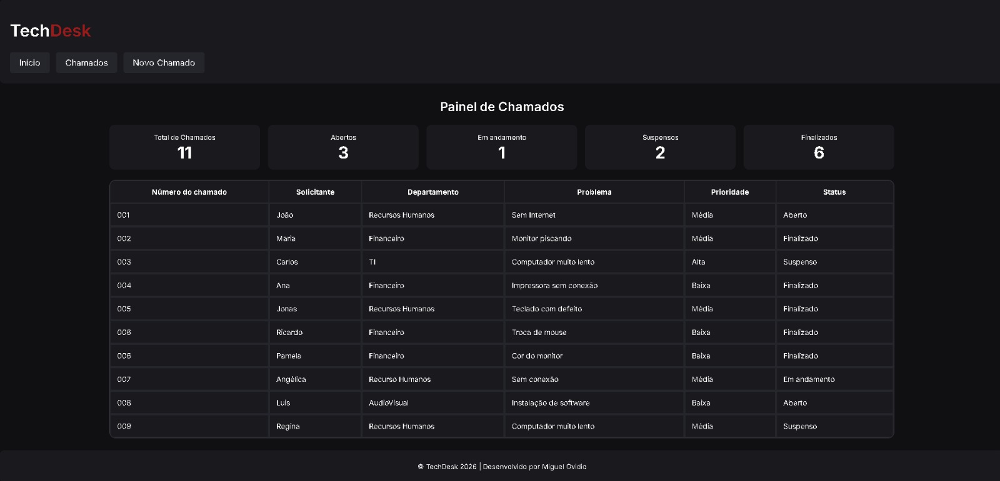
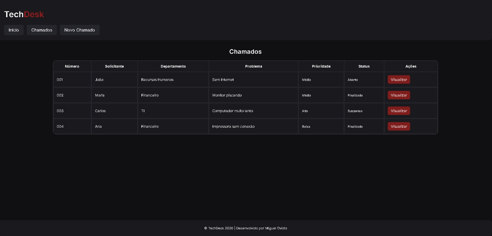
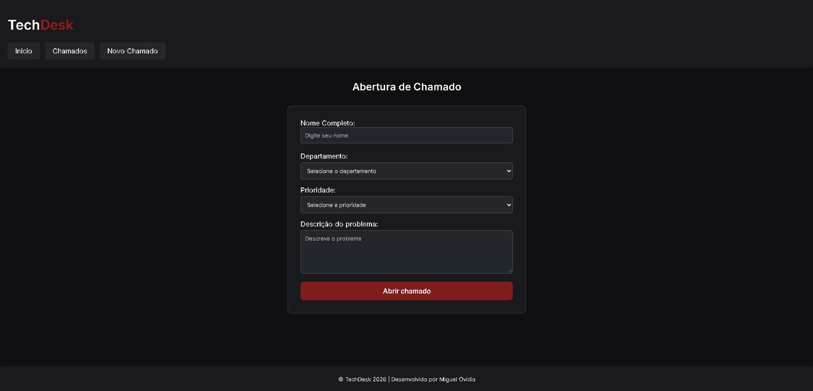

# TechDesk | Registros Visuais

Esta pasta reúne capturas de tela do TechDesk durante
seu desenvolvimento.

O objetivo é registrar visualmente a evolução do
projeto, acompanhando as mudanças realizadas na
interface ao longo das atualizações.

---

## Atualização 01 | 28/10/2026

Primeiros registros da interface do TechDesk.

### Tela 01

### Tela 02

### Tela 03

---

## Próximas atualizações

Novas capturas serão adicionadas conforme o
desenvolvimento do sistema avançar.

**Status do projeto:** Em desenvolvimento.

---

[Voltar ao repositório principal](../README.md)
